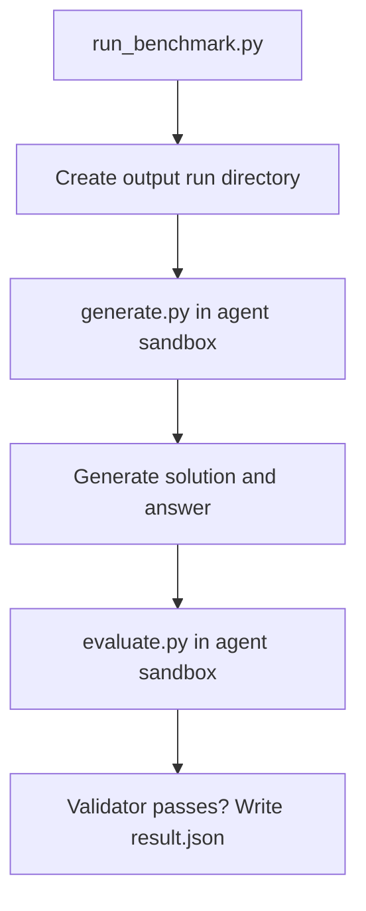

# DataAgentBench Runner

This directory contains the runner for the dataframe-native DataAgentBench tasks in this repository.

The runner separates solution generation from evaluation:



## Prerequisites

We use docker container as the agent sandbox, can mount the files into docker container, some files that we dont want agent change are read-only, others are read-write.

Not sure if it works on Windows:

- Docker Desktop or Docker Engine running Linux containers
- The `dfarena-agent-sandbox:latest` image
- A local Codex configuration directory, normally `~/.codex`

Build the sandbox image from the repository root:

```bash
docker build \
  -f docker/agent-sandbox.Dockerfile \
  -t dfarena-agent-sandbox:latest .
```

The image includes both terminal agents:

- `codex`
- `opencode`

The image does not contain API keys. Authentication is provided at runtime by mounting the host agent configuration into the container. For example, the Codex generation flow mounts the host Codex directory into `/root/.codex`:

```bash
docker run --rm \
  -v "$HOME/.codex:/root/.codex:rw" \
  dfarena-agent-sandbox:latest \
  codex exec ...
```

This means the container uses the host's existing authentication and API configuration. The credentials are not copied into the image or committed to the repository. Keep the host configuration directory outside the repository and never replace it with a path containing credentials in a checked-in command or script.

For OpenCode, the same principle applies when it is launched inside the sandbox: mount the host OpenCode configuration read-only when possible, for example:

```bash
docker run --rm \
  -v "$HOME/.config/opencode:/root/.config/opencode:ro" \
  -e OPENCODE_CONFIG=/root/.config/opencode/opencode.json \
  dfarena-agent-sandbox:latest \
  opencode run ...
```

Use `:rw` only when the agent must update local authentication state or cache files. For normal benchmark execution, read-only authentication mounts are preferred. The current `generate.py` Codex path uses `--codex-config-dir` and mounts that directory at `/root/.codex`.

## Dataset layout

Each dataset follows the same structure, which contains (data, context, task, answer). 

```text
DataAgentBench/<dataset>/
├── context/
│   ├── description.md
│   └── hints.md
├── data/
├── metadata.yaml
└── tasks/
    └── task1/
        ├── task.json
        └── answer/
            ├── ground_truth.csv
            └── validate.py
```

The task's `answer/` directory is used only by the evaluation container. It is never mounted into the agent container during generation.

## Run a benchmark task

The simplest command runs generation and evaluation in sequence:

```bash
python DataAgentBench/scripts/run_benchmark.py \
  --dataset DataAgentBench/stockindex \
  --task task1 \
  --agent-model codex_gpt-6 \
  --backend pandas
```

Available backends are:

- `pandas`
- `polars`
- `ibis`

For example, run the same task with Polars:

```bash
python DataAgentBench/scripts/run_benchmark.py \
  --dataset DataAgentBench/stockindex \
  --task task1 \
  --agent-model codex_gpt-6 \
  --backend polars
```

Use a different Codex configuration directory when needed:

```bash
python DataAgentBench/scripts/run_benchmark.py \
  --dataset DataAgentBench/bookreview \
  --task task2 \
  --backend ibis \
  --codex-config-dir ~/.codex-bench
```

## Run generation and evaluation separately

Separate execution is useful when debugging a failed solution or inspecting generated code.

```bash
RUN_DIR=DataAgentBench/stockindex/output/task1/manual/pandas/r001
mkdir -p "$RUN_DIR"

python DataAgentBench/scripts/generate.py \
  --dataset DataAgentBench/stockindex \
  --task task1 \
  --agent-model manual \
  --backend pandas \
  --run-dir "$RUN_DIR"

python DataAgentBench/scripts/evaluate.py \
  --dataset DataAgentBench/stockindex \
  --task task1 \
  --run-dir "$RUN_DIR"
```

The default sandbox image can be overridden for either script with `--image`.

## Run outputs

`run_benchmark.py` writes output under:

```text
DataAgentBench/<dataset>/output/<task>/<agent-model>/<backend>/rNNN/
├── detail/
│   ├── codex_stdout.jsonl
│   └── result.json
├── solution/
│   ├── answer.json
│   └── solution.py
├── work/
└── result.json
```

The `output/` directory is local experiment state and is ignored by Git. Do not commit generated solutions, logs, token usage, or run metadata unless a result is intentionally being published as a separate artifact.

## Docker sandbox and file mounts

Docker is used as the agent sandbox. The runner mounts only the files needed for the current stage. Inputs and instructions that the agent must not modify are mounted read-only (`:ro`); the working directory where the agent writes code and answers is mounted read-write (`:rw`).

For example, during generation the runner mounts:

```text
DataAgentBench/stockindex/data/              -> /workspace/data       (read-only)
DataAgentBench/stockindex/context/           -> /workspace/context    (read-only)
DataAgentBench/stockindex/tasks/task1/task.json -> /workspace/task.json (read-only)
DataAgentBench/stockindex/output/.../work/   -> /workspace/work       (read-write)
```

In Docker terms, the mounts look like:

```bash
docker run --rm \
  -v "$DATA_DIR:/workspace/data:ro" \
  -v "$CONTEXT_DIR:/workspace/context:ro" \
  -v "$TASK_FILE:/workspace/task.json:ro" \
  -v "$WORK_DIR:/workspace/work:rw" \
  dfarena-agent-sandbox:latest ...
```

The agent can read the Parquet inputs and task context, but it cannot overwrite them. It can create or update files such as `/workspace/work/solution.py` and `/workspace/work/answer.json`.

Evaluation uses a separate sandbox and adds the generated solution and hidden validator:

```text
run/solution/  -> /workspace/solution  (read-write)
tasks/task1/answer/ -> /workspace/answer (read-only)
```

The `answer/` directory is never mounted during generation, so hidden ground truths and validators are not exposed to the agent while it is solving the task.

## Adding a dataset

1. Add the dataset directory under `DataAgentBench/`.
2. Convert input tables to Parquet under `data/`.
3. Add documentation under `context/`.
4. Add one `task.json` and one `answer/validate.py` per task.
5. Add `metadata.yaml` with table paths, sizes, row counts, and checksums.
6. Run at least one task with each supported backend that the dataset is intended to support.

PostgreSQL, DuckDB, and SQLite are all databases, and usually contains tabular data tables, and can be converted into Parquet files. For MongoDB, we should discuss how to convert into our benchmark. 

Large datasets should not be committed directly to this repository. Publish them as a versioned Hugging Face dataset and keep the repository metadata, schema, download instructions, and checksums here.
