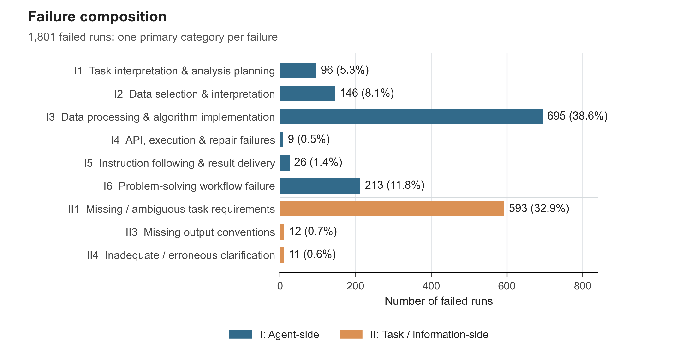
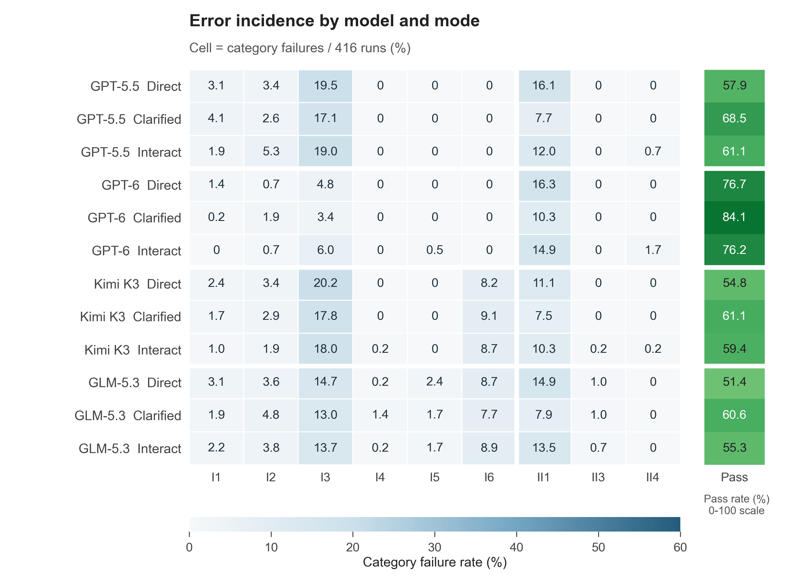
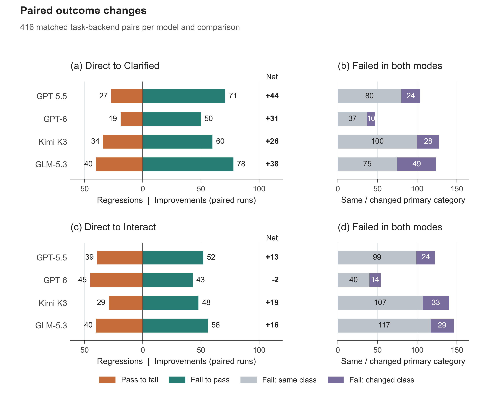
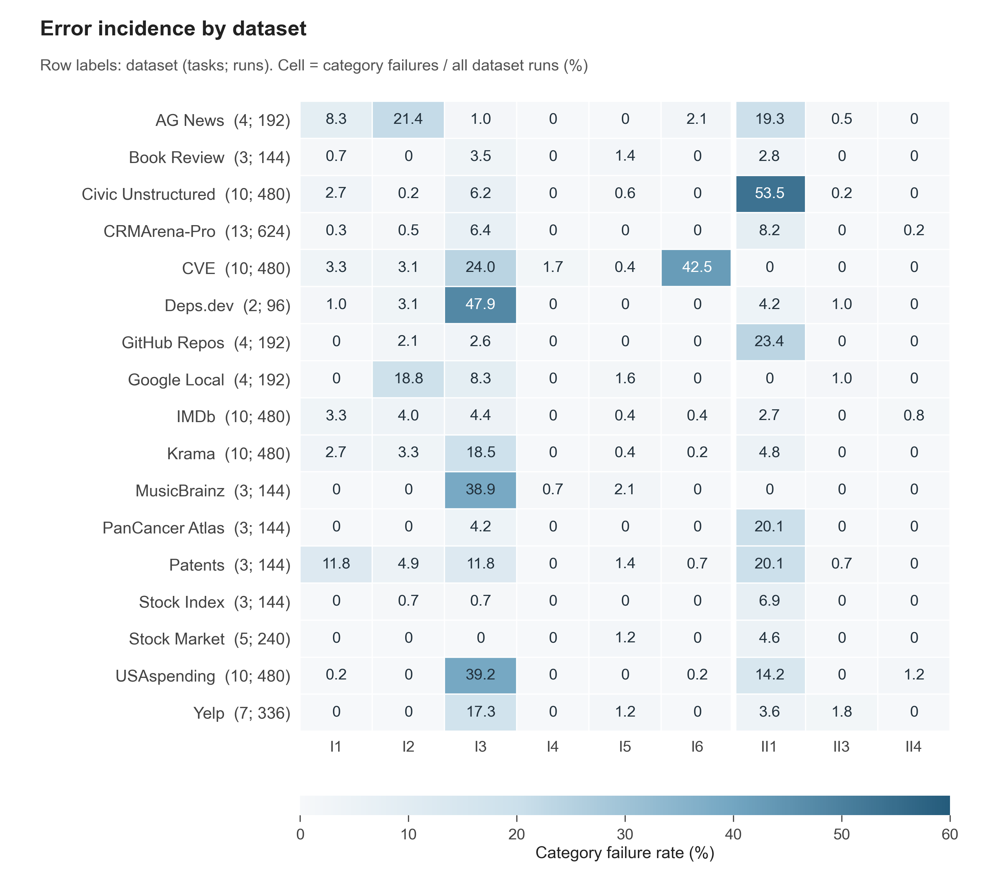

# DAB错误分析：第一版四张主图

2026-10-26。使用已确定的v0.3分类主表，盲标记录只用于分类质量验证，不替换绘图标签。图表及以下结论均为描述性统计。未新增实验、改分或改类。

## 先看什么

1. **主要失败集中在I3、II1、I6**：695、593、213条，合计1501/1801（83.3%）。其中I类1185（65.8%），II类616（34.2%）。这里的百分比分母是失败运行数。
2. **Clarified对四个模型均有净改善，Interact并非总有改善**：GPT-6 interact相对direct修复43条，也新增45条失败，净少通过2条。不能把净差理解为只存在2条差异。
3. **错误类型有明显的数据集集中现象**：I6中204/213（95.8%）来自CVE；II1中257/593（43.3%）来自Civic Unstructured。这不意味着其他数据集没有对应问题，也不能将全量运行当独立题目。
4. **更换数据集权重会改变比例**：各数据集等权时，失败构成中的I3/II1/I6约为40.0%/32.1%/7.9%；原始运行加权为38.6%/32.9%/11.8%。I3与II1仍是前两类，但I6的总体比例对题族构成敏感。

## 四张图与图注

图中文字使用英语，便于进入论文；中文解释在这里。所有图均提供PDF、可编辑文字的SVG、400 dpi PNG。图宽7.2英寸，按信息密度规划双栏展示；不是A4纸页。正文通常8–8.5 pt，标题10–11 pt。目标会议确定后可按其模板统一调整。

### 图1：九类错误分布

[PDF](fig1_error_distribution.pdf) · [SVG](fig1_error_distribution.svg)

**读法：** 蓝色为I类，橙色为II类；每条失败只记一个主类别。条末同时标计数与占1801条失败的比例。类别按正式编号排列，保留稀有类别。

**English caption:** Primary failure categories across 1,801 failed DAB runs. Bars show counts and percentages of all failed runs. Each run receives exactly one primary category. Blue and orange distinguish agent-side and task/information-side categories, respectively. Categories follow the established v0.3 annotation scheme; independent blind-review labels do not replace these primary annotations.

### 图2：模型×模式错误发生率

[PDF](fig2_model_mode_heatmap.pdf) · [SVG](fig2_model_mode_heatmap.svg)

**读法：** 每行416条运行（104题×4后端）。错误单元格是“该类失败数÷该行全部416条”，右侧单列通过率；九类发生率加通过率在舍入前为100%。它不是“某类占该模型失败的比例”。两个蓝色热图共用0–60%色阶；绿色通过率单独使用0–100%色阶。

**English caption:** Failure incidence by model and information mode. Each row includes 416 runs over 104 tasks and four backends. Each cell reports the percentage of all runs in that row assigned to a failure category. Pass rates are displayed separately on a 0–100% scale. The failure heatmap shares a 0–60% color scale with Figure 4. Zero denotes an observed zero count, not missing data.

### 图3：同题配对的改善、退化与失败类别变化

[PDF](fig3_paired_transitions.pdf) · [SVG](fig3_paired_transitions.svg)

**读法：** 同一模型、数据集、任务、后端配对，每个比较416对。左侧分别画“direct通过→目标失败”和“direct失败→目标通过”，粗体为净增通过。右侧只展示两个模式都失败的对子，区分主类别相同或变化。两边都通过的数量在下表列出；因此没有丢弃任何配对。主类别变化是标签层面的变化，不自动证明实际机制发生因果转移。

**English caption:** Paired outcome changes from Direct to Clarified (a,b) and Interact (c,d). Each comparison contains 416 matched task-backend pairs per model. Panels (a,c) display pass-to-fail regressions and fail-to-pass improvements; bold values give the net change in passed runs. Panels (b,d) partition pairs that fail in both modes into unchanged and changed primary categories. Both-pass counts are provided in the accompanying table. These are descriptive paired comparisons, not isolated causal effects of clarification.

|模型|目标模式|错→对|对→错|净增通过|错→同类错|错→不同类错|对→对|配对总数|
|---|---|---:|---:|---:|---:|---:|---:|---:|
|GPT-5.5|Clarified|71|27|+44|80|24|214|416|
|GPT-6|Clarified|50|19|+31|37|10|300|416|
|Kimi K3|Clarified|60|34|+26|100|28|194|416|
|GLM-5.3|Clarified|78|40|+38|75|49|174|416|
|GPT-5.5|Interact|52|39|+13|99|24|202|416|
|GPT-6|Interact|43|45|-2|40|14|274|416|
|Kimi K3|Interact|48|29|+19|107|33|199|416|
|GLM-5.3|Interact|56|40|+16|117|29|174|416|

### 图4：数据集×错误类别

[PDF](fig4_dataset_heatmap.pdf) · [SVG](fig4_dataset_heatmap.svg)

**读法：** 覆盖17个数据集；行名括号依次给出题数与全部运行数。每题48条（4模型×3模式×4后端）。单元格以该数据集全部运行数为分母，不能将题量不同的数据集直接按失败绝对数比较。图2和图4的相同蓝色表示相同发生率。

**English caption:** Failure incidence across 17 DAB datasets. Row labels list the number of tasks and runs, respectively; each task contributes 48 runs across four models, three modes, and four backends. Cells report category-specific failures as a percentage of all runs in that dataset. The color scale is identical to Figure 2. Counts and denominators are retained in the accompanying data export.

## 类别释义

|编号|正式中文名称|图中英文简写|
|---|---|---|
|I1|任务理解与分析方案错误|Task interpretation & analysis planning|
|I2|数据选择与解释错误|Data selection & interpretation|
|I3|数据处理与算法实现错误|Data processing & algorithm implementation|
|I4|API、执行与修复失败|API, execution & repair failures|
|I5|指令落实与结果交付错误|Instruction following & result delivery|
|I6|求解流程失效|Problem-solving workflow failure|
|II1|任务口径与必要信息缺失或歧义|Missing / ambiguous task requirements|
|II3|输出约定缺失|Missing output conventions|
|II4|澄清信息不充分、错误或矛盾|Inadequate / erroneous clarification|

II2已经并入II1；沿用正式编号，不为图表重新编号。英文为图内简写，分类边界仍以中文规范和逐条证据为准。超时是运行表象，不单独充当根因类，也不一律归I6。

## 数据集权重敏感性补充

以下不是新评分或新分类，主结果仍保留全部4992条。表中I3/II1/I6为对应加权失败集合中的构成比例。

|统计方式|保留运行数|通过率|I3占失败|II1占失败|I6占失败|
|---|---:|---:|---:|---:|---:|
|全量运行等权|4992|63.9%|38.6%|32.9%|11.8%|
|17个数据集等权|4992|65.5%|40.0%|32.1%|7.9%|
|排除CVE|4512|68.1%|40.3%|41.2%|0.6%|
|排除Civic Unstructured|4512|66.8%|44.5%|22.5%|14.2%|
|同时排除两者|4032|71.8%|48.4%|29.6%|0.8%|

每题都有48条，因此题目等权与全量运行等权完全相同。数据集等权的计算先在每个数据集内计算“各类别失败/全部运行”和通过率，再对17个数据集取平均；失败构成最后以加权失败率归一化。不是直接把17个数据集内部的失败构成平均。删去题族仅检验描述性结论是否敏感，不作为改善后的正式成绩。

## 口径与可复现性

- 4992个最终有效结果：3191通过、1801失败，104个任务、4个模型、3种模式、4个后端。每个组合覆盖相同104题。
- 主表有1803条历史注释，其中2条现已重评分通过。先筛有效索引中`passed=false`，再按`sample_id`连接正式标签；1801条失败无缺标、无身份或结果哈希错配。
- 最终有效结果遵循已完成的1800秒补跑政策，但实际保存结果中有3206条600秒预算、1786条1800秒预算；没有将原来已完成的600秒结果统统重跑。来源为4739条原始结果、242条超时替换、11条环境替换。
- 使用当前授权的Stock Market task3重评分索引：先按200字符重评，保留45条通过；只对剩余3条按500字符再评。原始模型答案未更改。以有效`passed`为准，不用历史`raw_evaluation_passed`替代。
- 保留原始实验结果和分类主表；两轮独立盲标用于质量验证，没有覆盖正式分类。现有标签包括共同讨论确定的部分和AI初审部分，不把覆盖率当分类准确率。
- 本组图是既定模型、工具、提示和评估设置下的描述统计，没有声称分离了harness影响。同一题跨模式/模型/后端有关联；不把4992条当4992个独立任务，不添加无依据的置信区间或显著性星号。
- `plot-input-records.json`保存用于绘图的逐行精简字段、实际预算、来源、结果指纹和正式标签；`figure-data.json`保存全部计数、分母、8个完整10×10配对矩阵与敏感性计算。
- `make_figures.py`读取并校验冻结输入SHA256；统一管理配色、字体与尺寸。修改数据版本必须先核实和更新预期指纹，不会静默读入其他分类版本。
- `validation.json`记录输入指纹和结构检查；`qa/`保存PDF渲染检查记录。PDF字体已嵌入，SVG保留文字，PNG为400 dpi。输出时按7.2英寸宽检查，避免将整张密集热图硬缩至单栏。

冻结输入SHA256：

|输入|SHA256|
|---|---|
|current-root-annotations-v0.3.json|ef5efa9d56a825eb9fd5822d2af9d58542e51144f8ab3810b95a63bf4f048a86|
|rescore-stockmarket-task3-window500/effective-run-index.json|6058b7d4e6772e0f743aa4bf8910e58fa1f44ac72fd7883182a2b9bd8bf97a55|
|DAB_ERROR_ANALYSIS.md|0568bcf9788ba0d1cdf900ad8205456c4bbb3dacac29832917ce9402cd67eed7|

## 视觉参考及采用范围

- 已实际检查[PrepBench的PVLDB论文](https://www.vldb.org/pvldb/vol19/p2866-wang.pdf)印刷页2874–2875的Figure7–12：借鉴紧凑布局、统一颜色含义、细轴线、浅网格和直接数值标注。
- 参考[LongDS Figure6及相关说明](https://arxiv.org/html/2605.30434v3#S5)的分组错误分析与多面板组织；该参考核查的是文本和图注，不声称复刻其视觉版式。
- [VLDB 2026格式指南](https://www.vldb.org/2026/formatting-guidelines.html)要求按会议模板排版；Arial、A4比例或不超过5种颜色不是统一硬性要求。此次采用Arial和双栏图宽是本项目的设计选择。
- 用户提供的小红书截图仅作参考：采用统一配色、字体、对齐、可编辑导出和视觉复核，不将截图中所有建议当成规范。

后续可从这些图选择论文主图，结合代表性轨迹解释I3、II1、I6和II4的具体机制。盲标一致性表独立放在方法验证部分；正式标签未修订时，不另画“盲标版本”的错误分布。
